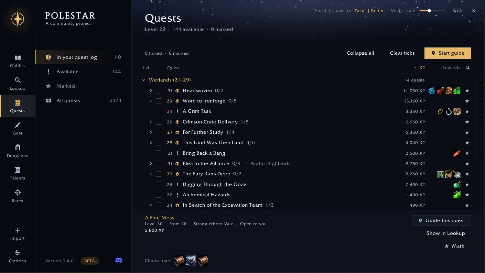
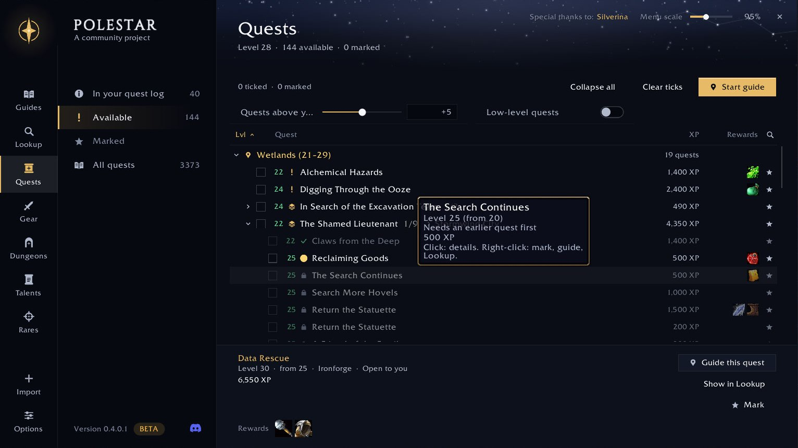
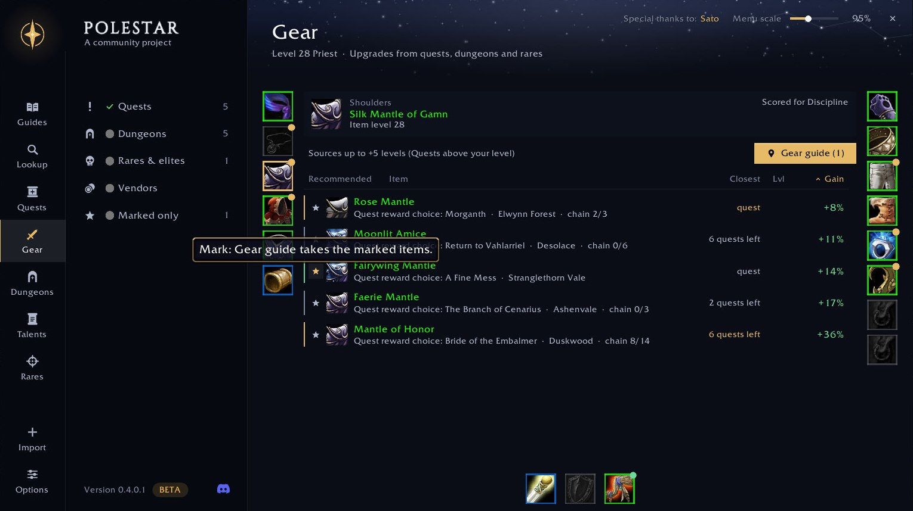
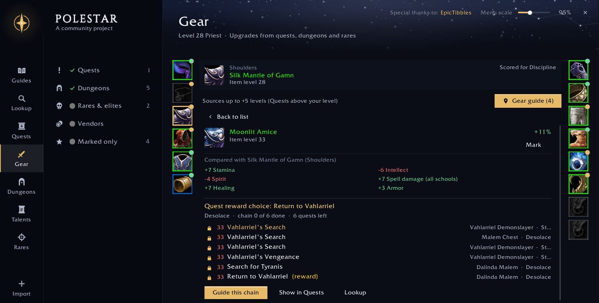
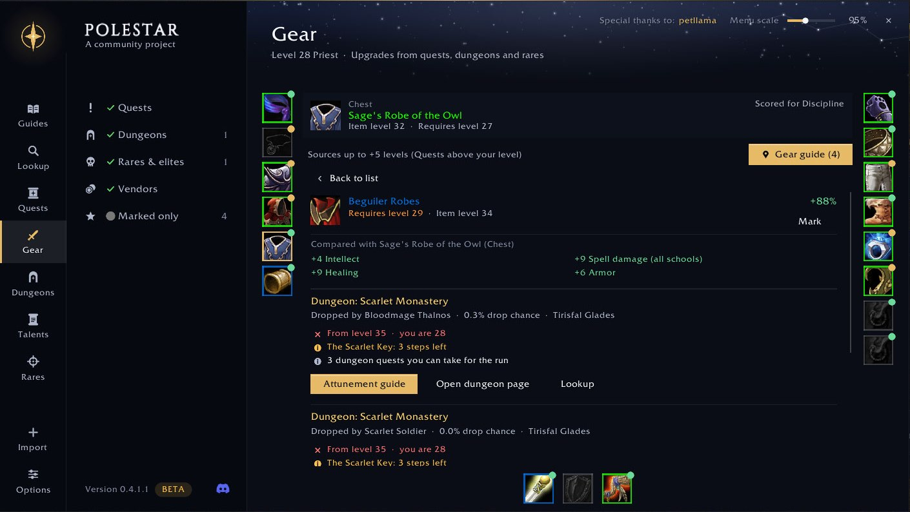
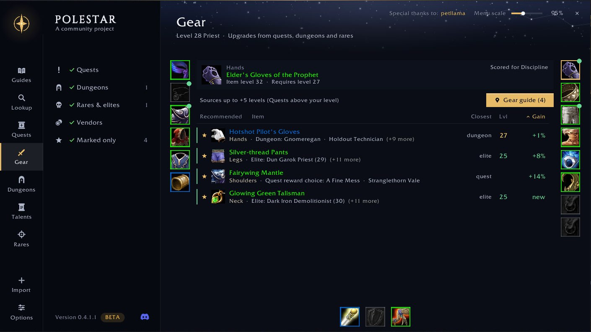

# Polestar Freestyle

**Pick your own quests and gear in [Polestar](https://github.com/fitzforge/polestar), and let it guide you there.**

A community addon for Polestar It adds a **Quests** and a **Gear** section to Polestar's hub, and a
guide for whatever is in your quest log.

> Not made by the Polestar team and not an official Polestar feature. Report problems with this addon
> [here](https://github.com/amateur-tinkerer/Polestar_Freestyle/issues), not to Polestar.

## What it does

| | |
|---|---|
| **Quests** | Every quest you can take, by zone and chain: level, XP for you now, length, objectives, story and rewards. Tick what you want and get one guide that does it in order. |
| **Gear** | The upgrades for each slot from quests, dungeons, rares and vendors, scored with Polestar's own stat weights. Star the ones you want and get one guide to all of them. |
| **Freestyle questing** | Polestar's guide window, arrow and map for the quests already in your log, nearest first. |

## Install

1. Install [Polestar](https://github.com/fitzforge/polestar) 0.4.1 or newer.
2. Download `Polestar_Freestyle-vX.Y.Z.zip` from the
   [latest release](https://github.com/amateur-tinkerer/Polestar_Freestyle/releases/latest).
3. Unzip it into `World of Warcraft\_forever_\Interface\AddOns\`, so `Polestar_Freestyle` sits next to
   `Polestar`.

To update, unzip the new release over the old folder. Neither the addon nor the Polestar Client updates it
for you.

**Coming from Polestar_FreeQuest (0.4.3 or older)?** The addon was renamed. Delete the old
`Polestar_FreeQuest` folder, or both copies load at once. To keep your marked quests and gear, rename
`Polestar_FreeQuest.lua` to `Polestar_Freestyle.lua` in `WTF\Account\<account>\SavedVariables\` and in
each character's `WTF\Account\<account>\<realm>\<character>\SavedVariables\`. Do this with the game
closed.

## Quests

Open it from the **Quests** icon on the hub, or `/polestar quests`.

<table>
<tr>
<td width="50%"></td>
<td width="50%"></td>
</tr>
<tr>
<td>A chain, opened: done quests fold away, the next one is first.</td>
<td>Your quest log, nearest first, with the quest details below.</td>
</tr>
</table>

**Four lists** in the sidebar:

| List | Shows |
|---|---|
| In your quest log | Your quests, nearest first, with **Near you** on top |
| Available | What you can pick up now, your zone first |
| Marked | Quests you starred |
| All quests | Every quest your character can do |

**Each row** shows the level (coloured by difficulty), the XP it gives you now, its rewards, and a
**Length** meter: one to three bars from the quest's XP tier, a skull for elite mobs, a door for a dungeon.
Click **Lvl**, **Quest**, **XP**, **Rewards** or **Near** to sort; click again to reverse.

**Click a quest** for its details:

- **Objectives:** "Kill 10 Dragonmaw Raiders", "Collect 6 Blueleaf Tuber". Elites, rares and bosses are
  named as such. Quests in your log show your progress.
- **Story:** the first lines of the quest text. Click it to read the rest.

**Near you** (in your quest log) lists what is close: quests to hand in, your objectives, and quests to
pick up from givers nearby. It follows you as you move, in minutes on foot or yards.

**Tick and go.** Tick quests, chains, or a whole zone (Near you included), then **Start guide**. Each chain
starts at the first quest you haven't done, prerequisites first, and the guide replans as you hand in.

Also: **Ctrl+F** searches quest and reward names (`staff of westfall`), right-click a quest to mark it,
guide it or open it in Lookup, and the stars on Lookup's item pages mark quests from there.

## Gear

Open it from the **Gear** icon (the sword), or `/freequest gear`.

Click a slot to see what you wear and every upgrade for it.

- **Gain** is the same percentage Polestar's tooltips show, from your spec's stat weights. An empty slot
  shows "new" and a percent, measuring the pieces against the best one.
- **Lvl** is the level needed to wear it. Most quest rewards need none, so the quest's level shows dimmed.
- **Closest** is how you get it. A coin means a vendor sells it.
- Filter sources: Quests, Dungeons, Rares & elites, Vendors. Only items your class can wear are listed.
- **Marked only** lists every item you starred, from all slots. **Gear guide** takes you to all of them.

<table>
<tr>
<td width="50%"></td>
<td width="50%"></td>
</tr>
<tr>
<td><b>Quest reward:</b> the stat changes and the whole chain to it. Guide it, or open it in Quests with the reward outlined.</td>
<td><b>Dungeon drop:</b> a checklist of level, keys, attunements and dungeon quests, with a guide button.</td>
</tr>
</table>

When a page sends you elsewhere (Quests, a dungeon, Lookup), **‹ Back** at the top left returns you to
exactly where you were, one step at a time.

## Freestyle questing

A guide for the quests already in your log. Each quest gets a step at its objectives and a hand-in step,
nearest first, updated as you accept, finish or abandon quests.

| Command | Does |
|---|---|
| `/polestar free` or `/freestyle` | Opens Freestyle questing in its own guide tab |
| `/polestar free wetlands` | One zone's quests (part of a name works: `dusk`) |
| `/polestar free all` | Every quest in your log |
| `/polestar free zone` | Back to the zone you're in |
| `/polestar free refresh` | Plans again now |
| `/polestar free close` | Closes the tab |

## Options

Open the **Polestar Freestyle** page in Polestar's Options with the sliders button on the Quests page, or
`/freestyle options`.

| Setting | Default |
|---|---|
| Measure the way in: time on foot or yards | Time |
| Near you reaches | 2.5 minutes on foot |
| Near you lists at most | 10 quests |
| Quests to hand in / to pick up | On |

**Quests above your level** and **Low-level quests** stay on the Quests page. They are Polestar's own
settings, shared with its map markers.

## Commands

| Command | Opens |
|---|---|
| `/polestar quests` | Quests |
| `/freequest gear` | Gear |
| `/freestyle options` | Options |
| `/polestar free` | Freestyle questing |

## Data and credits

- Quests, items, dungeons and gear scores come from Polestar (`Polestar_Codex`, `Polestar_ItemDB`, its gear
  advice). A quest in the wrong place is Polestar's data: report it with `/polestar report`.
- Quest text for quests you haven't seen yet comes from Efficient Games'
  [EG Link dataset for WoW: Forever](https://github.com/JIVESCORP/eg-link-output-wowf) (CC BY 4.0). Quests
  you have seen use the text the game showed you. The quest text itself is Blizzard's. See
  [LICENSE-DATA.txt](LICENSE-DATA.txt).
- Polestar internals it uses are checked first, so a Polestar update that changes them switches off that
  part instead of breaking the rest.

## Reporting a problem

Open an [issue](https://github.com/amateur-tinkerer/Polestar_Freestyle/issues) with your Polestar and
addon versions, class and level, what you clicked, and a screenshot if you can.

## License

GPL-3.0-only, the same as Polestar.
